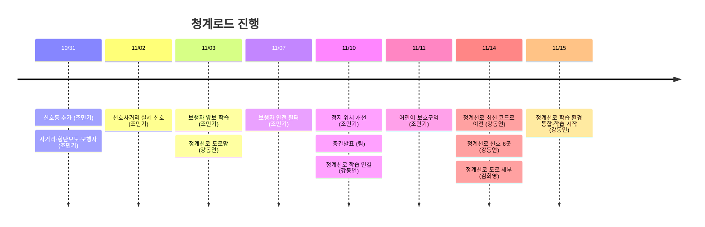

# 청계로드 작업 기록

> 청계천 자율주행 버스(청계A01) 노선을 SUMO로 재현하고, 사람이 개입해야 하는 지점을 찾아 줄이는 프로젝트

## 지금 어디까지 왔나 (2026-11-14)

| 구분 | 상태 | 한 줄 |
|---|---|---|
| 천호사거리 환경 | ✅ 학습 완료 | 실제 신호·보행자·안전 필터·어린이 보호구역까지, 1,000판 충돌 0.5% |
| 청계천로 도로 | ✅ 학습 코드 연결 완료 | 실제 지도 기반 2.1 km, 신호 6곳, 단순 운전으로 끝까지 주행 확인 |
| 청계천로 학습 | 🔄 학습 중 | 희영님 도로 + 정류장 정차 + 안전 필터 통합, Kaggle에서 시드 3개 학습 중 |

## 다음에 할 일

1. 최신 모델을 청계천로에서 돌려보기 (학습·데이터 담당)
2. 청계천로에 어린이 보호구역, 버스정류장 11곳 넣기 (도로 담당) — 신호 보강은 11/14 완료
3. 버스 최고속도를 시속 30 km에 맞출지 정하기 (팀)

## 브랜치 안내

| 브랜치 | 무엇이 들어 있나 | 담당 |
|---|---|---|
| `main` | 천호사거리 + 안전 필터 + 정지 위치 개선 (11/10 기준) | 조민기 |
| `school_zone` | main + 어린이 보호구역 | 조민기 |
| `feature/cgc-train` | **청계천로 학습용 (가장 최신)**: 희영님 도로 + 신호 + 정류장 정차 + 안전 필터 | 강동연·김희영 |
| `feature/huiyoung-oneway` | 청계천로 도로 세부 (정류장·차로수·보호구역·주정차) | 김희영 |
| `feature/cgc-school` | school_zone + 청계천로 (이전 버전) | 강동연 |
| `feature/cgc-env` | crosswalk + 청계천로 (이전 버전) | 강동연 |
| `feature/cheonggyecheon` | 청계천로 도로만 (처음 버전) | 강동연 |

## 진행 흐름



## 날짜별 보고서

| 날짜 | 누가 | 무엇을 | 보고서 |
|---|---|---|---|
| 10/31 | 조민기 | 직선 도로에 신호등, 빨간불에 서도록 학습 | [보기](reports/2026-10-31_조민기_신호등_추가.md) |
| 10/31 | 조민기 | 사거리 + 횡단보도 + 보행자 환경 | [보기](reports/2026-10-31_조민기_교차로_보행자_환경.md) |
| 11/02 | 조민기 | 천호사거리 실제 신호 시간, 좌회전 차로 | [보기](reports/2026-11-02_조민기_천호사거리_실제신호.md) |
| 11/03 | 조민기 | 보행자 보고 양보하기 학습 | [보기](reports/2026-11-03_조민기_보행자_양보_학습.md) |
| 11/03 | 강동연 | 청계천로 실제 도로망 만들기 | [보기](reports/2026-11-03_강동연_청계천로_도로망.md) |
| 11/07 | 조민기 | 보행자 안전 필터 | [보기](reports/2026-11-07_조민기_보행자_안전필터.md) |
| 11/10 | 조민기 | 정지 위치 자연스럽게 | [보기](reports/2026-11-10_조민기_정지위치_개선.md) |
| 11/10 | 팀 | 중간발표, 역할 분담 | [보기](reports/2026-11-10_팀_중간발표.md) |
| 11/10 | 강동연 | 청계천로를 학습 코드에 연결 | [보기](reports/2026-11-10_강동연_청계천로_학습연결.md) |
| 11/11 | 조민기 | 어린이 보호구역 | [보기](reports/2026-11-11_조민기_어린이보호구역.md) |
| 11/14 | 강동연 | 청계천로를 최신 코드 위로 옮기기 | [보기](reports/2026-11-14_강동연_청계천로_최신코드_이전.md) |
| 11/14 | 강동연 | 청계천로 버스 경로 신호 1곳 → 6곳 | [보기](reports/2026-11-14_강동연_청계천로_신호_보강.md) |
| 11/15 | 강동연 | 청계천로 학습 환경 통합 + Kaggle 학습 시작 | [보기](reports/2026-11-15_강동연_청계천로_학습환경_통합.md) |

## 용어 풀이

| 용어 | 뜻 |
|---|---|
| PPO | 이 프로젝트에서 쓰는 강화학습 방법. 차가 시행착오로 운전을 배운다 |
| 관측 (40개 값, 42개 값) | 차가 매 순간 보는 숫자 묶음. 개수가 같아야 같은 모델을 쓸 수 있다 |
| 안전 필터 | 보행자가 앞에 있으면 학습 결과와 상관없이 브레이크를 거는 규칙 |
| best_model / model | 학습 중 가장 성적이 좋았던 모델 / 마지막 모델 |
| 1,000판 평가 | 처음 보는 상황으로 1,000번 운전시켜 낸 성적 |
| 순간이동 (teleport) | SUMO가 오래 막힌 차를 강제로 옮기는 것. 0건이어야 도로가 정상 |

## 보고서 쓰는 법

큰 작업을 끝내면 `docs/reports/날짜_이름_제목.md`를 만들고 위 표에 한 줄 추가한다.

```markdown
# 제목

> **한 줄 요약** · 무엇을 했는지 한 문장

| 날짜 | 작성자 | 브랜치 | 커밋 |
|---|---|---|---|

## 왜 했나
## 한 일
## 결과
## 남은 일
```

팀원 작업의 수치는 각 커밋 메시지를 옮긴 것이다.
