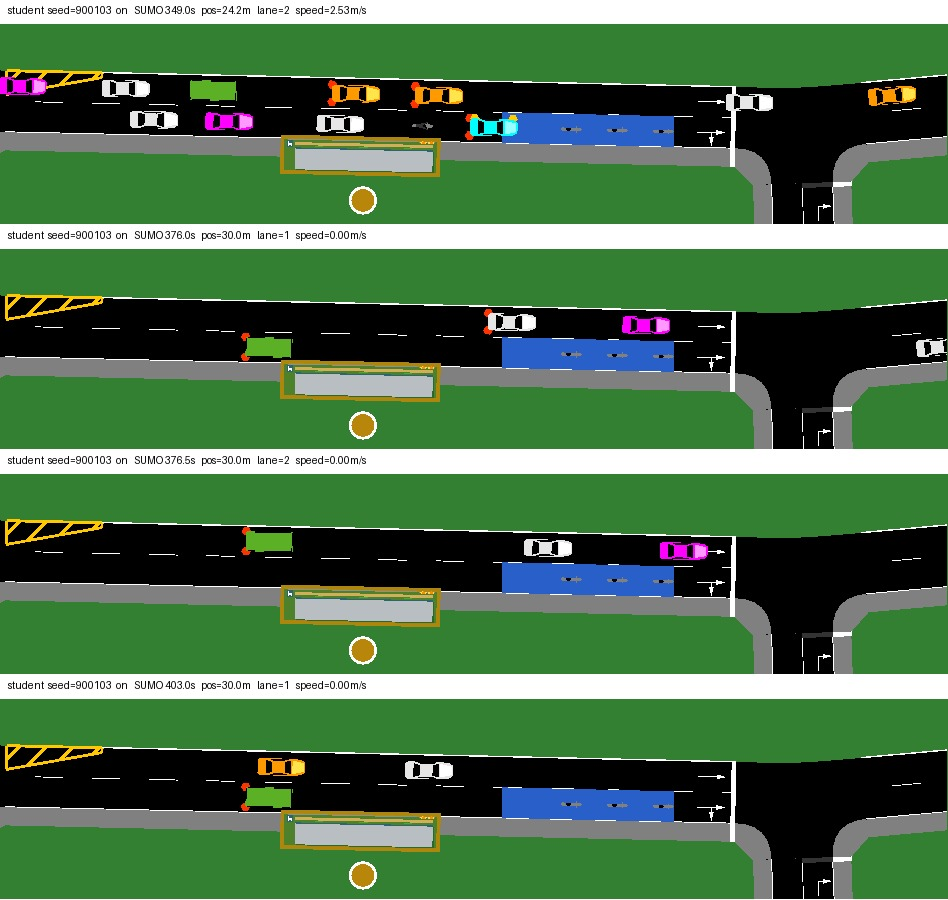
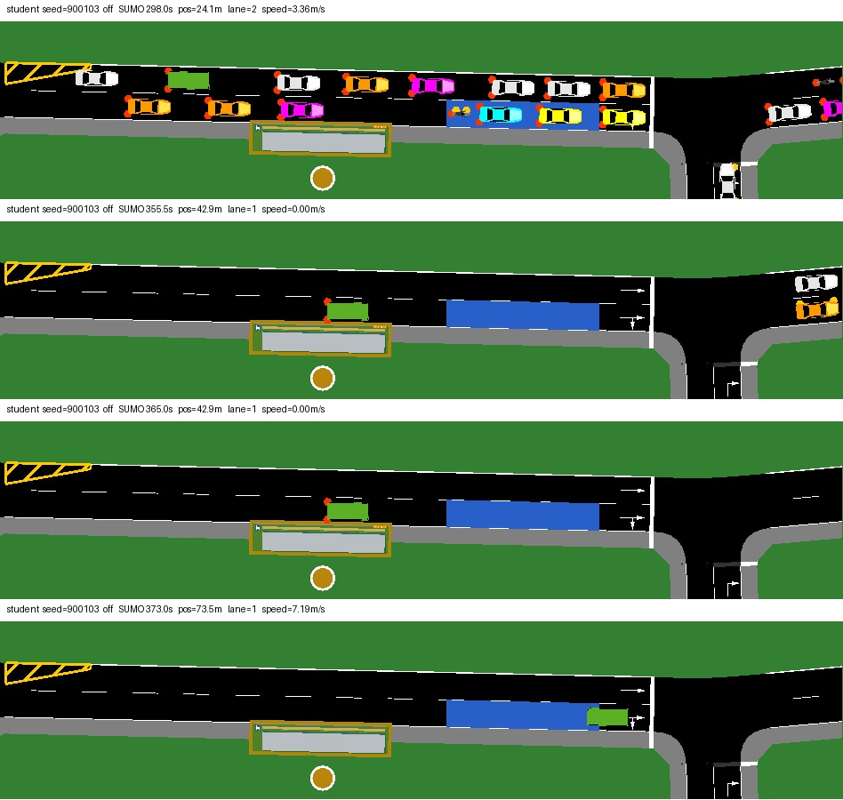
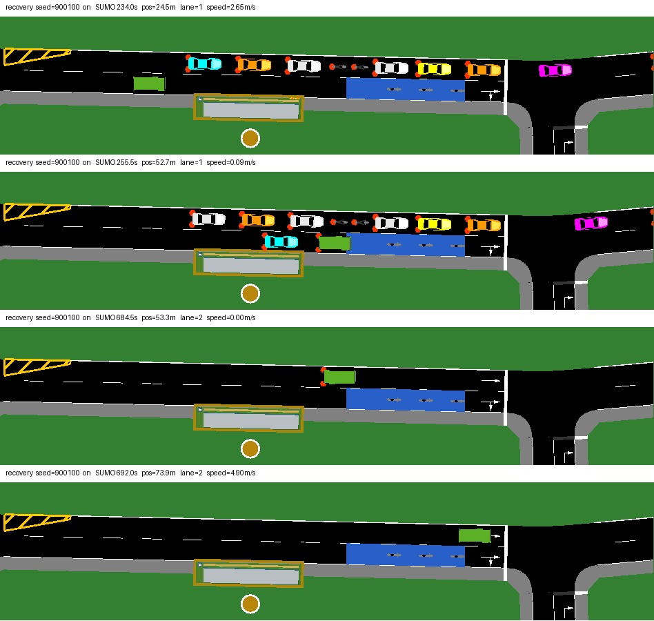
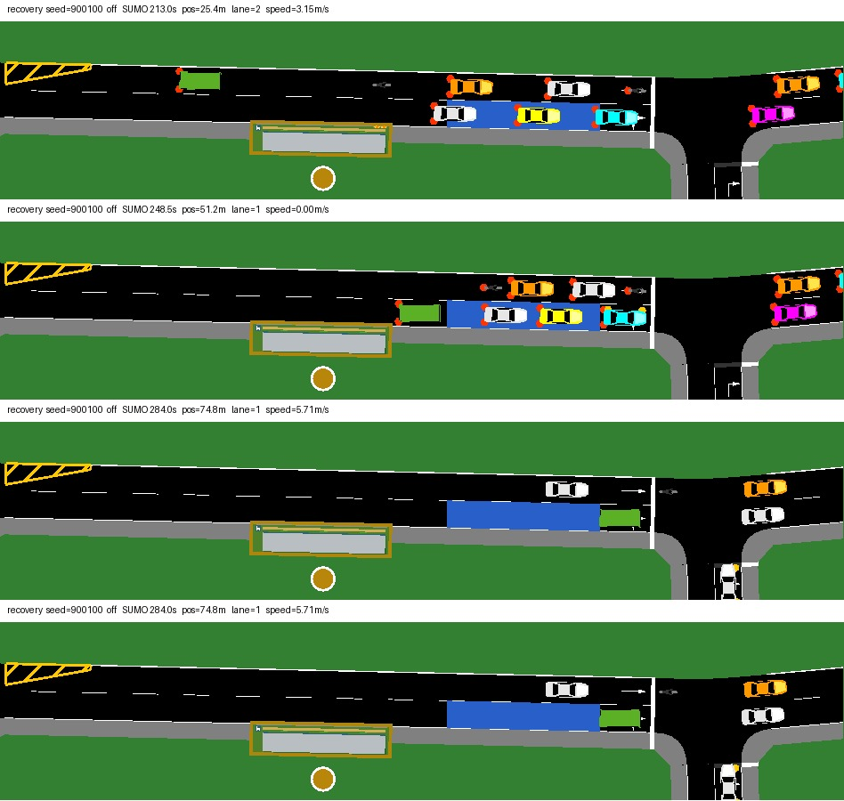
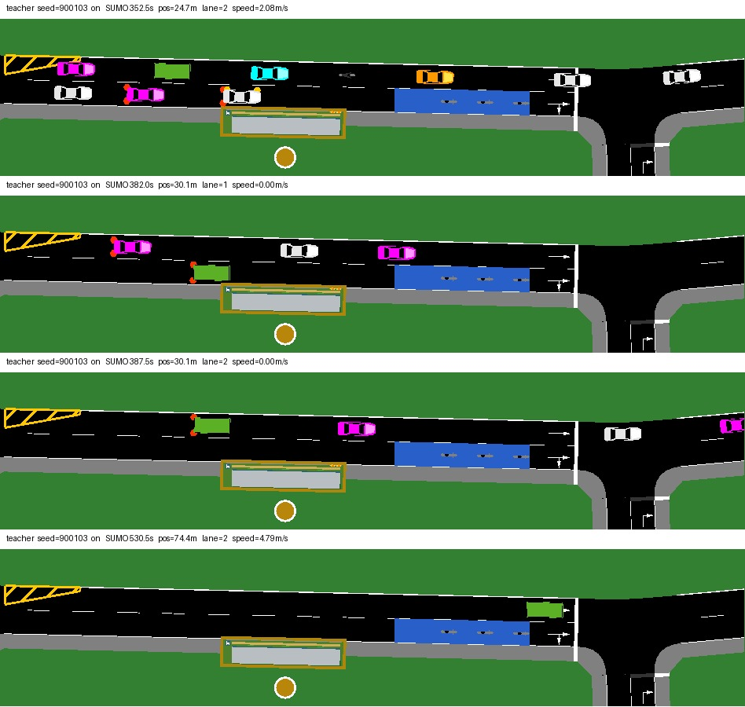
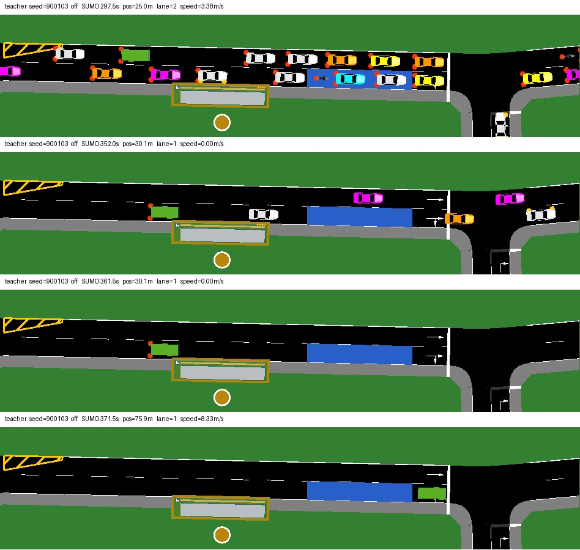
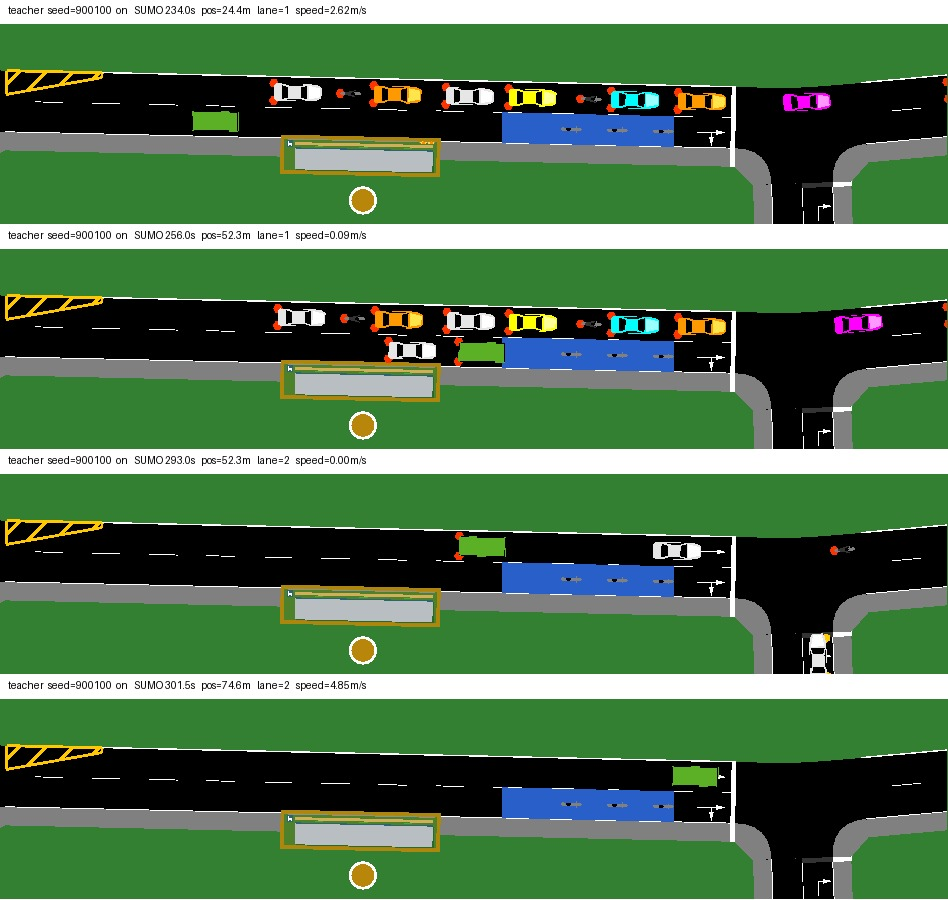
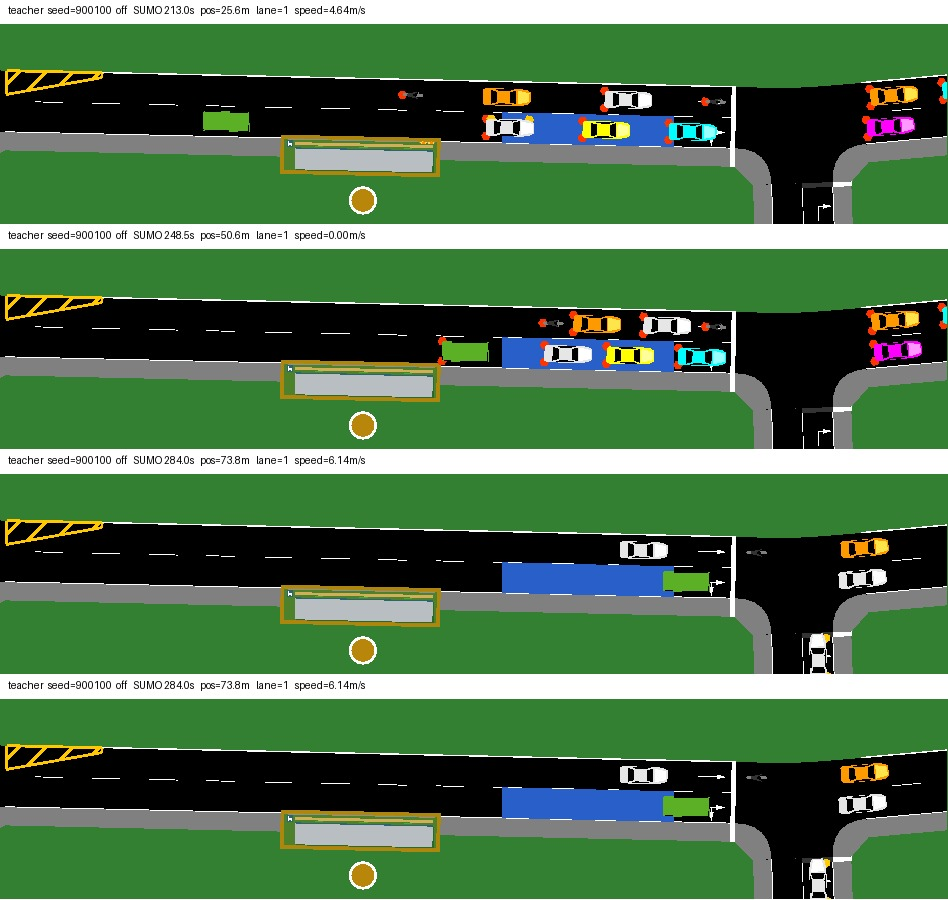

# 삼일대로 동쪽 주정차 대조 실험

정류장 bs_03은 차로 1의 30–45 m, samil_east는 같은 차로의 52–70 m다. 동일 모델·시드에서 DISABLE_SAMIL_EAST=1만 바꿨다. 이륜차 종류·수 추첨과 주변 차량 초기 배치용 자리 예약은 두 조건에서 동일하게 처리했다. 실제 배치 수는 SUMO에 존재한 차량 ID와 좌표로 확인했다.

핑퐁은 bs_03을 향하는 동안 같은 edge의 25–50 m에서 관측된 5초 이내 실제 반대 차로 이동 횟수다. 정차 성공은 환경의 stop_success로 확인했다. 주정차 구간 최장 정지는 52–70 m 안에서 속도 0.1 m/s 미만인 연속 시간이다. 이 지표는 통제 비교용으로 신호색을 걸러내지 않는다.

[기존 판 위치 재집계](2026-11-26_s6_위치재집계.md)

| 정책 | 시드 | 이륜차 조건 | 실배치 | bs_03 핑퐁 | 10초 정차 | samil 최장 정지 | 종료 |
|---|---:|---|---:|---:|---|---:|---|
| student | 900103 | on | 3 | 48 | 실패 | 0.0초 | collision |
| student | 900103 | off | 0 | 0 | 성공 | 0.0초 | completed |
| recovery | 900100 | on | 3 | 0 | 성공 | 429.5초 | completed |
| recovery | 900100 | off | 0 | 0 | 성공 | 0.0초 | completed |
| teacher | 900103 | on | 3 | 84 | 성공 | 68.5초 | completed |
| teacher | 900103 | off | 0 | 0 | 성공 | 0.0초 | collision |
| teacher | 900100 | on | 3 | 0 | 성공 | 37.5초 | completed |
| teacher | 900100 | off | 0 | 0 | 성공 | 0.0초 | completed |

## 화면 및 규칙 로그

### student 900103 · on

실제 주정차 앞범퍼 위치(m): 70.0, 65.1, 60.3.

[349.0초 원본](img/student_900103_on_52bf725_00349.0.png) · [376.0초 원본](img/student_900103_on_d8e4db2_00376.0.png) · [376.5초 원본](img/student_900103_on_0e22963_00376.5.png) · [403.0초 원본](img/student_900103_on_5f7338a_00403.0.png)

### student 900103 · off

실제 주정차 앞범퍼 위치(m): 없음.

[298.0초 원본](img/student_900103_off_e361799_00298.0.png) · [355.5초 원본](img/student_900103_off_8d5fcaf_00355.5.png) · [365.0초 원본](img/student_900103_off_a58a506_00365.0.png) · [373.0초 원본](img/student_900103_off_1f3d59a_00373.0.png)

### recovery 900100 · on

실제 주정차 앞범퍼 위치(m): 70.0, 65.1, 60.3.

[234.0초 원본](img/recovery_900100_on_1ffbc5a_00234.0.png) · [255.5초 원본](img/recovery_900100_on_d2f68d0_00255.5.png) · [684.5초 원본](img/recovery_900100_on_2122a2c_00684.5.png) · [692.0초 원본](img/recovery_900100_on_0a382da_00692.0.png)

### recovery 900100 · off

실제 주정차 앞범퍼 위치(m): 없음.

[213.0초 원본](img/recovery_900100_off_5d346de_00213.0.png) · [248.5초 원본](img/recovery_900100_off_c8a1dae_00248.5.png) · [284.0초 원본](img/recovery_900100_off_97175db_00284.0.png) · [284.0초 원본](img/recovery_900100_off_97175db_00284.0.png)

### teacher 900103 · on

실제 주정차 앞범퍼 위치(m): 70.0, 65.1, 60.3.

[352.5초 원본](img/teacher_900103_on_ce29014_00352.5.png) · [382.0초 원본](img/teacher_900103_on_f50ecb7_00382.0.png) · [387.5초 원본](img/teacher_900103_on_5564a07_00387.5.png) · [530.5초 원본](img/teacher_900103_on_c9f62c7_00530.5.png)

정류장 규칙의 유지가 후속 규칙에서 변경으로 바뀐 스텝 43회. 그중 실제 차로가 바뀐 스텝 43회.

### teacher 900103 · off

실제 주정차 앞범퍼 위치(m): 없음.

[297.5초 원본](img/teacher_900103_off_0d6749c_00297.5.png) · [352.0초 원본](img/teacher_900103_off_b5ad2f5_00352.0.png) · [361.5초 원본](img/teacher_900103_off_72b0209_00361.5.png) · [371.5초 원본](img/teacher_900103_off_548bc3d_00371.5.png)

정류장 규칙의 유지가 후속 규칙에서 변경으로 바뀐 스텝 0회. 그중 실제 차로가 바뀐 스텝 0회.

### teacher 900100 · on

실제 주정차 앞범퍼 위치(m): 70.0, 65.1, 60.3.

[234.0초 원본](img/teacher_900100_on_b57e6c2_00234.0.png) · [256.0초 원본](img/teacher_900100_on_f4b16ee_00256.0.png) · [293.0초 원본](img/teacher_900100_on_c6991c6_00293.0.png) · [301.5초 원본](img/teacher_900100_on_f4ad20d_00301.5.png)

정류장 규칙의 유지가 후속 규칙에서 변경으로 바뀐 스텝 0회. 그중 실제 차로가 바뀐 스텝 0회.

### teacher 900100 · off

실제 주정차 앞범퍼 위치(m): 없음.

[213.0초 원본](img/teacher_900100_off_30ea939_00213.0.png) · [248.5초 원본](img/teacher_900100_off_8fcb9d3_00248.5.png) · [284.0초 원본](img/teacher_900100_off_1322438_00284.0.png) · [284.0초 원본](img/teacher_900100_off_1322438_00284.0.png)

정류장 규칙의 유지가 후속 규칙에서 변경으로 바뀐 스텝 0회. 그중 실제 차로가 바뀐 스텝 0회.

